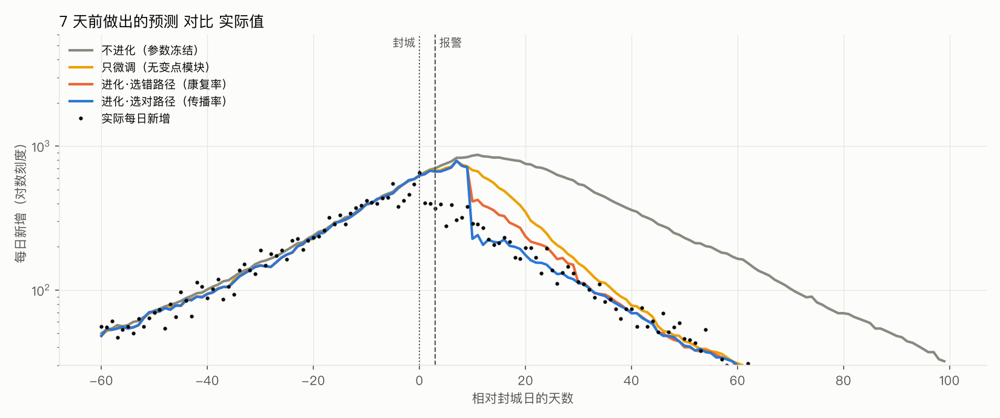
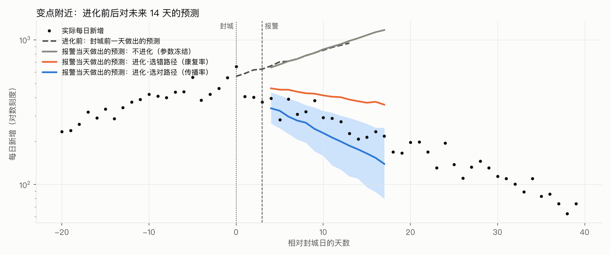
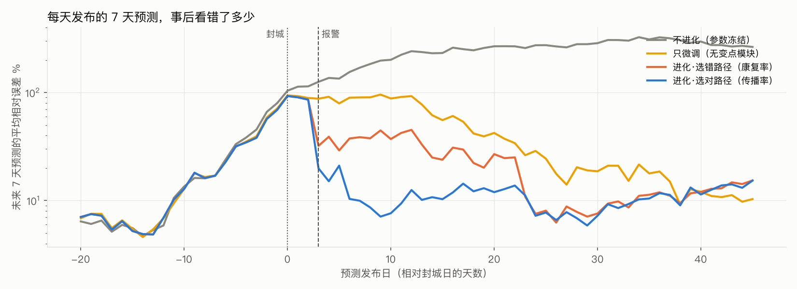
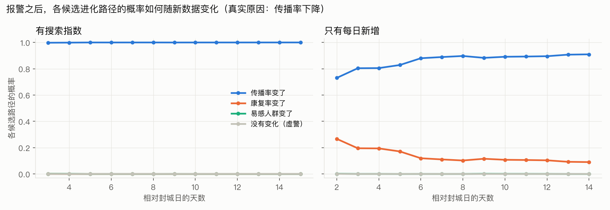
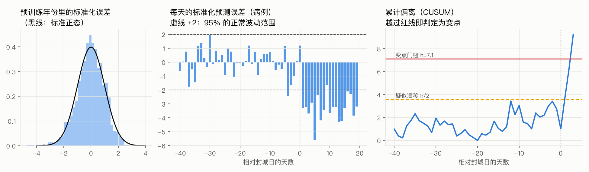
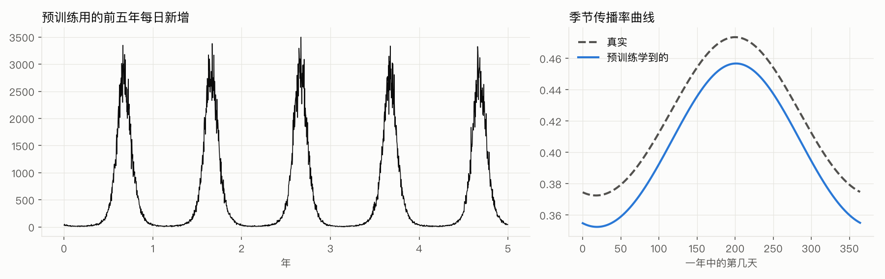

# 日新·流感版：会自我进化的季节性流感预测——基于 SEIRS 与集合卡尔曼滤波的技术报告

> BoHack 2026 参赛作品技术报告（主题“日新”）。代码目录：`fluevo/`；结果文件：`out_flu/results.json`；图：`out_flu/图1…图6*.png`。
>
> **先说三件事（后文第 12 节会展开）：① 全部结果来自仿真数据，没有任何真实疫情数据；② 仿真器和滤波器用的是同一套方程和同一批常数（同构），所以结果偏乐观；③ 没有使用神经网络，也没有做文献调研。**

---

## 目录

0. 摘要
1. 问题设定
2. 符号表
3. 机理模型
4. 仿真数据怎么生成
5. 集合卡尔曼滤波（EnKF）
6. 预训练
7. 标准化预测误差、CUSUM 与分级（含门槛 h 的推导）
8. 候选进化路径与多模型概率
9. 预测如何产生
10. 模块划分与神经网络适用性
11. 实验设计、指标与结果
12. 局限
13. 复现指南

---

## 0 摘要

我们做了一个“每天都在自我修正”的流感预测系统。它的流程是：

1. **预训练**：用某城市（A 市）前五年的每日新增病例，估计一组初始参数（季节传播率曲线、免疫消退率、搜索指数的比例常数、观测噪声大小）。
2. **在线运行**：进入第六年后，每天先做预测，等当天真值到达后算“标准化预测误差”。误差小，只做卡尔曼滤波的常规微调。
3. **变点检测**：把标准化预测误差累计起来（CUSUM），累计偏离超过门槛 $h$ 就判定“世界变了”（变点）。$h$ 不是拍脑袋定的，而是用“模型没问题时平均 5 年才误报一次”的要求，通过 Siegmund 近似反推出来的（有搜索指数时 $h=7.1$，只有病例时 $h=6.4$）。
4. **候选进化路径**：同一个异常误差，可以由多种参数变化解释（传播率下降？康复率上升？易感人群突增？还是根本没变，只是虚警？）。系统为每条路径各开一个滤波器，用新到的数据逐日更新每条路径的概率，列出“路径—概率”，由人（或搜索指数这类物理信息）确认；人不给信息时，自动取概率最高的路径。
5. **沿选定路径继续进化**，之后的未来 7 天预测就准了。

**“两次运行”的含义**：在变点处，对同一段未来做两次预测——**第一次是进化前的预测**（沿用变点前的参数），**第二次是进化后的预测**（换成选定路径的参数）。两次预测与随后到来的真值对比，就能直观看到“进化”带来了多少改进。

**主要结果**（仿真，20 个随机种子，封城情景“传播率 ×0.6”，见第 11 节）：报警后 1–7 天预测的平均相对误差为：参数冻结 204.8%，只微调 70.0%，进化但选错路径 30.0%，**进化且选对路径 11.6%**。需要注意：“选错路径 30.0%”是在带搜索指数的条件下强制选错得到的；只用每日新增时，选错路径对短期病例预测的影响很小（第 2–3 周 MAPE 12.4% 对 11.2%），主要后果是把原因解释错（见 11.6 节）。不给人工信息时自动选对路径的正确率：有搜索指数 100%（三种情景），只有病例 42%–68%。无变化的对照年里，每年虚警 0.05 次。

**如实声明**：没有使用神经网络；结果全部来自仿真；仿真器与滤波器同构；没有做文献调研。

---

## 1 问题设定

### 1.1 我们想解决什么

传染病预测常用的做法是：用历史数据把模型参数拟合一次，然后一直用下去。问题在于，现实中会突然发生**政策或病原体的变化**（封城、开放、新药、新毒株），参数一变，旧模型的预测就会系统性地错。我们希望预测系统能**自己发现“该换参数了”，并搞清楚“换哪个参数”**。

### 1.2 设定

- 一座 A 市，人口固定为 $N=5\times10^6$。
- **前五年**（第 0 至 1824 天）是“历史”，只用来预训练。
- **第六年**（第 1825 至 2189 天，共 365 天）是“在线运行期”：每天预测、每天用真值检验。
- 每天能观测到两路数据：**每日新增报告病例** $y_t$，以及**搜索指数** $s_t$（正比于当前患病人数，可缺失）。
- 第六年里可能发生变点。实验里设定为“第六年第 195 天封城，传播率乘 0.6”（第 4 节）。

### 1.3 要回答的问题

1. 误差小的时候怎么办？（只微调。）
2. 误差累计到什么程度才算变点？门槛怎么定？（第 7 节，由误报率反推。）
3. 变点发生后，误差可由多种参数变化解释，怎么办？（列候选路径和概率，第 8 节。）
4. 选对路径后，未来 7 天的预测真的更准吗？（第 11 节。）

### 1.4 “两次运行”

在变点处，对**同一天出发、同一段未来**，做两次预测并与真值对比：

| | 含义 | 在图中对应 |
|---|---|---|
| 第一次运行（进化前） | 沿用变点前的参数做预测 | 图 2 的灰色虚线（封城前一天做出的预测）、灰色实线（参数冻结） |
| 第二次运行（进化后） | 换成选定路径的参数再做预测 | 图 2 的蓝线（选对路径）、橙线（选错路径） |

---

## 2 符号表

下表列出本文所有符号。“代码名”一列指向 `fluevo/` 中的变量。

### 2.1 时间与人口

| 符号 | 含义 | 代码名 / 取值 |
|---|---|---|
| $t$ | 绝对天数（从记录开始算，第 0 天是第一年第 1 天） | `t` |
| $d$ | 一年中的第几天，$d=t \bmod 365$ | `t % YEAR` |
| $Y$ | 一年的天数 | `YEAR = 365` |
| $N$ | A 市总人口（固定） | `N = 5e6` |
| $S_t,E_t,I_t,R_t$ | 第 $t$ 天开始时的易感者、潜伏者、患病者、康复（免疫）者人数 | `S,E,I,R` |
| $T_0$ | 在线运行的起点（预训练数据长度） | `T0 = 5*365 = 1825` |
| $T_c$ | 封城发生的绝对天 | `TC = T0+195 = 2020` |

### 2.2 机理参数

| 符号 | 含义 | 代码名 / 取值 |
|---|---|---|
| $\sigma$ | 潜伏期结束速率（平均潜伏 2 天） | `SIGMA = 0.5` |
| $\gamma_0$ | 基准康复率（病程约 3.3 天） | `GAMMA0 = 0.3` |
| $\gamma_t$ | 第 $t$ 天的康复率 | `gamma` |
| $\omega$ | 免疫消退率 | 真值 `OMEGA_TRUE = 1/250` |
| $\beta_t$ | 第 $t$ 天的传播率 | `beta` |
| $b_0,b_1,b_2$ | 季节传播率的傅里叶系数 | `b0,b1,b2` |
| $\mathrm{AMP},\ \mathrm{PEAK}$ | 季节幅度、季节峰值日（仿真器参数） | `AMP_TRUE=0.12`, `PEAK_TRUE=200` |
| $m_t=\log(\text{传播率干预乘子})$ | 干预乘子的对数，平时为 0 | 状态 `lm` |
| $g_t=\log(\text{康复率乘子})$ | 康复率乘子的对数，平时为 0 | 状态 `lg` |
| $\ell_\omega=\log\omega$ | 免疫消退率的对数（预训练时当作状态） | 状态 `lw` |
| $\lambda$ | 外来输入病例（每天） | `IMPORT = 10` |
| $w_t$ | 季节相位 $2\pi (t\bmod 365)/365$ | `w` |

### 2.3 观测

| 符号 | 含义 | 代码名 / 取值 |
|---|---|---|
| $y_t$ | 第 $t$ 天报告的新增病例 | `y` |
| $s_t$ | 第 $t$ 天的搜索指数 | `s` |
| $\rho$ | 报告率（10% 的发病被报告） | `RHO = 0.10` |
| $\phi$ | 病例计数的负二项离散度 | `PHI_TRUE = 100` |
| $c$ | 搜索指数与患病人数的比例常数 | 仿真真值 `SEARCH_C = 0.02`；滤波器中为估计值 `c` |
| $\tau_s$ | 搜索指数的对数噪声标准差 | `SEARCH_SD = 0.15` |
| $\mu_t$ | 第 $t$ 天新增病例的期望，$\mu_t=\rho\,\sigma E_t$ | `mu` |
| $z_t^{(1)},z_t^{(2)}$ | 两路“对数观测”：$\log(y_t+1)$、$\log s_t$ | `z` |
| $h_i^{(1)},h_i^{(2)}$ | 第 $i$ 个集合成员的预测观测 | `h` |

### 2.4 滤波器

| 符号 | 含义 | 代码名 / 取值 |
|---|---|---|
| $n$ | 集合成员数 | `n = 300` |
| $\mathbf{x}_i$ | 第 $i$ 个成员的增广状态向量 | `x` |
| $\bar{\mathbf{h}}$ | 集合平均的预测观测 | `hm` |
| $P_{zz}$ | 预测观测的协方差（集合离散 + 观测噪声） | `Pzz` |
| $R=\mathrm{diag}(r^{(1)},r^{(2)})$ | 观测噪声方差 | `r` |
| $r_{\text{case}},r_{\text{search}}$ | 观测噪声的校准系数 | `r_case, r_search` |
| $K$ | 卡尔曼增益 | `K` |
| $q$ | 传播过程噪声（对数标准差） | `q = 0.05` |
| $\eta_k$ | 参数 $k$ 随机游走的步长标准差 | `rw` |
| $\nu^{(j)}_t$ | 第 $j$ 路观测的标准化预测误差 | `nu` |
| $\ell_t$ | 第 $t$ 天的预测对数似然 | `loglik` |

### 2.5 变点检测与多路径

| 符号 | 含义 | 代码名 / 取值 |
|---|---|---|
| $k$ | CUSUM 的参考值（松弛量） | `K_REF = 0.5` |
| $C^{+}_t,C^{-}_t$ | 正向、负向累计偏离 | `cus[0], cus[1]` |
| $h$ | 变点门槛 | `self.h` |
| $\mathrm{ARL}_0$ | 模型无误时平均多少天误报一次 | `cusum_arl` |
| $M$ | 同时监视的 CUSUM 图数（方向数 × 观测路数） | `n_charts` |
| $p\in\{\text{none},\beta,\gamma,\text{sus}\}$ | 候选路径 | `PRIOR` 的键 |
| $\pi_p$ | 路径 $p$ 的先验概率 | `PRIOR` |
| $\varsigma_p$ | 路径 $p$ 的跳变幅度先验标准差 | `PATHS` |
| $t_a$ | 报警日 | `alarm_day` |
| $o$ | 假设的变点起点 | `onset` |
| $L_{p,o}$ | 路径 $p$、起点 $o$ 的累计对数似然 | `self.L` |
| $\mathcal{E}_p$ | 路径 $p$ 对起点边际化后的对数证据 | `_path_logev` |
| $P(p\mid\text{数据})$ | 路径 $p$ 的后验概率 | `_probs` |
| $H$ | 预测步长 | `HORIZON = 7`（引擎里实际预测 14 天） |

---

## 3 机理模型

### 3.1 SEIRS 差分方程

人群分成四类：易感 $S$、潜伏 $E$、患病 $I$、康复 $R$。康复者以速率 $\omega$ 失去免疫，重新变回易感（所以叫 SEIRS 而不是 SEIR），这就是每年都会再次流行的原因。

在**滤波器**里（均值场、连续人数），一天的推进是：

$$\Lambda_t=\min\!\Big(\beta_t\,I_t\,\frac{S_t}{N}\,\epsilon_t+\lambda,\ S_t\Big)$$

$$S_{t+1}=S_t-\Lambda_t+\omega R_t,\qquad E_{t+1}=E_t+\Lambda_t-\sigma E_t$$

$$I_{t+1}=I_t+\sigma E_t-\gamma_t I_t,\qquad R_{t+1}=R_t+\gamma_t I_t-\omega R_t$$

**大白话**：$\Lambda_t$ 是今天新增的感染者数——传染概率正比于“患病人数 × 易感比例”，再加上每天 $\lambda=10$ 个外来病例（防止淡季疫情灭绝），不能超过易感人数；$\epsilon_t=\exp(\mathcal N(0,q^2))$ 是对数正态的过程噪声（滤波器里 $q=0.05$）。感染者先进入潜伏期 $E$，以每天 $\sigma$ 的比例转为患病 $I$，再以每天 $\gamma_t$ 的比例康复进入 $R$，康复者以每天 $\omega$ 的比例回到 $S$。四类人数之和不变，等于 $N$。

代码中对 $E,I,R$ 还有下限保护：`max(·, 1.0)`；$\gamma_t$ 有上限 0.95（`filter.py` `_advance`）。

**仿真器**里同一套方程用的是**随机整数版本**：$E\to I$、$I\to R$、$R\to S$ 的人数分别从二项分布抽取，新感染数从泊松分布抽取（第 4 节）。所以仿真器是随机的、整数的，滤波器内部是均值场加噪声的——这是二者方程“同构”但不完全一样的地方。

### 3.2 传播率方程

$$\log\beta_t=b_0+b_1\cos w_t+b_2\sin w_t+m_t,\qquad w_t=\frac{2\pi\,(t\bmod 365)}{365}$$

**大白话**：传播率的对数 = 一条随季节起伏的曲线（前三项：常数加一阶傅里叶）+ 一个“干预乘子的对数” $m_t$。平时 $m_t=0$；封城使 $m_t<0$（传播率乘以 $e^{m_t}<1$）；开放使 $m_t>0$。

仿真器里的季节曲线等价地写成 $\log\beta^{\text{season}}(t)=B_0+\mathrm{AMP}\cos\!\big(2\pi(t-\mathrm{PEAK})/365\big)$，其中 $B_0=\log 0.42$。由三角恒等式，它等价于傅里叶系数

$$b_0=B_0=\log 0.42\approx-0.8675,\quad b_1=\mathrm{AMP}\cos\frac{2\pi\,\mathrm{PEAK}}{365}\approx-0.1146,\quad b_2=\mathrm{AMP}\sin\frac{2\pi\,\mathrm{PEAK}}{365}\approx-0.0356$$

（`sim.py` `log_beta_season` 里就是这样转换的；数值是我用 AMP=0.12、PEAK=200 代入算的。）所以季节峰值在每年第 200 天，峰值传播率 $0.42\,e^{0.12}\approx0.4735$。

### 3.3 康复率

$$\gamma_t=\min\big(\gamma_0\,e^{g_t},\ 0.95\big),\qquad \gamma_0=0.3$$

**大白话**：康复率 = 基准 0.3 乘以一个乘子 $e^{g_t}$。平时 $g_t=0$；治疗手段改进使 $g_t>0$（康复更快）。上限 0.95 防止一天内转出超过 100%。

### 3.4 两路观测方程

**每日新增病例**。仿真器里，当天从潜伏转为患病的人数 $\mathrm{EI}_t\sim\mathrm{Binomial}(E_t,\sigma)$，其中 10% 被报告，并带负二项噪声：

$$y_t\sim\mathrm{NegBin}\big(\text{均值 }\mu_t=\rho\cdot\mathrm{EI}_t,\ \text{离散度 }\phi=100\big)$$

滤波器里用其期望 $\mu_t=\rho\sigma E_t$，并取对数：

$$z^{(1)}_t=\log(y_t+1),\qquad h^{(1)}=\log(\rho\sigma E_t+1)$$

**大白话**：每天报告的新增，大约是“当天从潜伏变成患病的人数的 10%”，再加一点计数噪声（离散度 100，单日波动约 ±10%）。取 $\log(\cdot+1)$ 是为了让噪声大小接近恒定，且 0 也能取对数。

**搜索指数**：

$$s_t=c\cdot\max(I_t,1)\cdot e^{\varepsilon},\ \ \varepsilon\sim\mathcal N(0,\tau_s^2),\ \tau_s=0.15;\qquad z^{(2)}_t=\log s_t,\quad h^{(2)}=\log(c\,I_t)$$

**大白话**：搜索指数正比于“当前正在生病的人数 $I$”，只带一点乘性噪声（约 15%）。它是个**与病例互补的物理信息**。

**为什么搜索指数能区分“传播率变了”和“康复率变了”**（此处引自 `流感版说明.md` 的机理解释，我据方程核对了方向，但并未单独做数学证明，属推断）：康复率上升，会让当前患病人数 $I$ 立刻下降，而当天新增病例由 $E$ 决定，要几天后才跟着降；传播率下降，则是新感染 $\Lambda$ 先降，$E$、$I$ 随后依次降。所以两路观测的“先后顺序”不同，同时看两路就能分辨。第 11 节的结果支持这一点：有搜索指数时选对路径的正确率是 100%，没有时只有 42%–68%。

---

## 4 仿真数据怎么生成

本节所有数值均来自 `fluevo/sim.py` 与 `fluevo/experiment.py`。

### 4.1 常数一览

| 常数 | 值 | 代码 |
|---|---|---|
| 人口 $N$ | $5\times10^6$ | `N = 5e6` |
| 潜伏转出率 $\sigma$ | 0.5 | `SIGMA` |
| 基准康复率 $\gamma_0$ | 0.3 | `GAMMA0` |
| 报告率 $\rho$ | 0.10 | `RHO` |
| 免疫消退率真值 $\omega$ | $1/250=0.004$ | `OMEGA_TRUE` |
| 季节基础 $B_0$ | $\log 0.42$ | `B0_TRUE` |
| 季节幅度 | 0.12 | `AMP_TRUE` |
| 季节峰值日 | 200 | `PEAK_TRUE` |
| 输入病例 $\lambda$ | 10/天 | `IMPORT` |
| 负二项离散度 $\phi$ | 100 | `PHI_TRUE` |
| 搜索比例常数 $c$ | 0.02 | `SEARCH_C` |
| 搜索对数噪声 $\tau_s$ | 0.15 | `SEARCH_SD` |
| 过程噪声（传播，乘性） | 0.05（对数标准差） | 硬编码在 `simulate` 中的 `np.random.normal(0, 0.05)` |
| 年长 | 365 | `YEAR` |
| 空跑年数 | 4 | `burn_years=4` |
| 记录年数 | 6 | `years=6` |
| 前期预训练 / 在线分界 | $T_0=1825$ | `experiment.T0` |

### 4.2 初始状态与“先空跑 4 年再记录 6 年”

初始状态（`simulate` 开头）：

$$S=0.72N,\quad E=300,\quad I=400,\quad R=N-S-E-I$$

循环变量 $t$ 从 $-4\times365=-1460$ 一直走到 $6\times365-1=2189$。$t<0$ 的 1460 天是**空跑期**（只推进状态、不记录观测），目的是让初始状态“忘掉”，进入循环往复的季节性稳态；$t\ge0$ 的 2190 天是**记录期**（共 6 年），其中前 1825 天为预训练数据，后 365 天为在线运行期。

### 4.3 每一天的随机抽样（按代码顺序）

设当天开始时状态为 $(S,E,I,R)$，随机数发生器为 `np.random.default_rng(seed)`。

1. **计算传播率**：$\beta=\exp\!\big(\log\beta^{\text{season}}(t)\big)\times(\text{若变点为传播率且已到点：}k\text{；否则 }1)$。
2. **计算康复率**：$\gamma=0.3\times(\text{若变点为康复率且已到点：}k;\text{ 否则 }1)$。
3. **“易感人群突增”情景**（`kind='sus'`）：仅在 $t=$ `change["day"]` 那一天，把比例 $k$ 的康复者一次性移回易感：$S\leftarrow S+kR,\ R\leftarrow R-kR$。（实验里没有用到这种情景。）
4. **三个二项抽样**：
   - $\mathrm{EI}\sim\mathrm{Binomial}(\lfloor E\rfloor,\sigma)$
   - $\mathrm{IR}\sim\mathrm{Binomial}(\lfloor I\rfloor,\min(\gamma,1))$
   - $\mathrm{RS}\sim\mathrm{Binomial}(\lfloor R\rfloor,\omega)$
5. **若 $t\ge0$（记录期）**：
   - $\mu=\rho\cdot\mathrm{EI}$；若 $\mu>0$，$y_t\sim\mathrm{NegBin}(n=\phi,\ p=\phi/(\phi+\mu))$，否则 $y_t=0$；
   - $s_t=0.02\times\max(I,1)\times\exp(\mathcal N(0,0.15^2))$（用的是当天**开始时**的 $I$）；
   - 同时记录真值轨迹（$S,E,I,\beta,\gamma$）。
6. **新感染数**：$\mathrm{newE}=\min\big(\mathrm{Poisson}(\beta I S/N\cdot e^{\mathcal N(0,0.05^2)}+10),\ S\big)$。
7. **状态更新**：$S\leftarrow S-\mathrm{newE}+\mathrm{RS}$，$E\leftarrow E+\mathrm{newE}-\mathrm{EI}$，$I\leftarrow I+\mathrm{EI}-\mathrm{IR}$，$R\leftarrow R+\mathrm{IR}-\mathrm{RS}$。

**大白话**：每天先用二项分布“掷骰子”决定有多少人从潜伏变患病、从患病康复、从康复失去免疫；再按当天传播率掷泊松骰子决定新感染多少；报告病例和搜索指数是在这些人数基础上再叠加噪声得到的。

### 4.4 封城情景

`experiment.py` 中：

$$T_0=5\times365=1825,\qquad T_c=T_0+195=2020,\qquad \text{LOCKDOWN}=\{\text{kind}=\text{'beta'},\ \text{day}=T_c,\ k=0.6\}$$

即：在线运行期的第 195 天（对应流行上升期），从该天起传播率**乘以 0.6**，一直持续到年底。基准传播率 $\beta$ 的平均水平 $0.42$ 乘 0.6 为 $0.252$，已经低于康复率 0.3（此为我据常数算出的推断：此时疫情会进入下降）。

实验中还用到另外两个情景（仅用于路径选择正确率统计，第 11 节）：康复率从 $T_c$ 起乘 1.6（“治疗改进”）、传播率从 $T_c$ 起乘 1.4（“开放”）。

---

## 5 集合卡尔曼滤波（EnKF）

代码：`fluevo/filter.py`。

### 5.1 为什么用 EnKF（简要）

我们要同时估计“人数状态”和“参数”，而方程是非线性的（$I\cdot S$ 相乘）。集合卡尔曼滤波用一批（$n=300$ 个）“平行世界”样本代替协方差矩阵：每个样本各自按方程往前走，再用观测把样本整体往真值方向拉。这样不需要写雅可比矩阵，代码也短。

### 5.2 增广状态向量

每个集合成员的状态向量为

$$\mathbf{x}=[\,S,\ E,\ I,\ R,\ m,\ g,\ (b_0,\ b_1,\ b_2,\ \ell_\omega)\,]^{\top}$$

其中 $m=\log(\text{传播率乘子})$、$g=\log(\text{康复率乘子})$ 是**在线运行期的“可进化参数”**；括号里的 $(b_0,b_1,b_2,\ell_\omega)$ **只在预训练时**当作待估状态（`est_theta=True`），在线时固定不变。

**大白话**：把“要估的参数”也当成“状态”，扔进同一个向量。这样滤波器在估计人数的同时，也会顺便把参数调整一下——这就是“增广”的含义。

### 5.3 预测步（推进）

每个成员独立地按第 3 节的方程推进一天，并加噪声：

- 传播过程噪声：$\epsilon=\exp(\mathcal N(0,q^2))$，$q=0.05$；
- 参数随机游走（默认）：$m\leftarrow m+\mathcal N(0,0.005^2)$，$g\leftarrow g+\mathcal N(0,0.002^2)$；$b_0,b_1,b_2,\ell_\omega$ 默认不游走（`rw` 为 0）。

$$\mathbf{x}_{t+1}^{-}=f(\mathbf{x}_t^{+})+\text{噪声}$$

**大白话**：参数的随机游走是在告诉滤波器“参数可能会慢慢漂”，这样集合里参数的离散度不会塌缩到零，滤波器才有“继续微调”的能力。游走步长越小，参数越“稳”。（`rw` 的默认值在 `Filter.__init__`：`lm=0.005, lg=0.002, b0=b1=b2=lw=0`。）

### 5.4 观测噪声方差的取法

每路观测的噪声方差（`_obs_var`）：

$$r^{(1)}=r_{\text{case}}\Big(\frac{1}{\bar\mu+1}+\frac{1}{\phi}\Big),\ \ \bar\mu=\frac1n\sum_i\rho\sigma E_i;\qquad r^{(2)}=r_{\text{search}}\,\tau_s^2=r_{\text{search}}\times0.15^2$$

**大白话**：病例是计数，计数取对数后，噪声方差大约是“泊松部分 $1/(\mu+1)$ + 负二项额外部分 $1/\phi$”——病例越多，对数后的相对噪声越小（这个近似式是代码里的写法；其推导我理解为对数的一阶展开，属推断）。搜索指数的噪声就是仿真器里已知的 0.15。$r_{\text{case}},r_{\text{search}}$ 是校准系数（预训练里用数据校准，第 6.5 节），默认为 1。

### 5.5 预测观测的协方差与标准化预测误差

先算每个成员的预测观测 $\mathbf h_i$（1 路或 2 路），集合平均 $\bar{\mathbf h}$，偏差 $\delta\mathbf h_i=\mathbf h_i-\bar{\mathbf h}$：

$$P_{zz}=\frac{1}{n-1}\sum_{i=1}^{n}\delta\mathbf h_i\,\delta\mathbf h_i^{\top}+R,\qquad \mathbf{e}=\mathbf z-\bar{\mathbf h},\qquad \nu^{(j)}=\frac{e^{(j)}}{\sqrt{P_{zz}^{(jj)}}}$$

**大白话**：“预测分布的方差”由两部分组成：集合内部各成员预测的分散程度（模型自己的不确定性），加上观测本身的噪声。$\mathbf e$ 是“真值减预测”，除以预测分布的标准差就得到**标准化预测误差 $\nu$**——模型没问题时，它应当近似服从标准正态 $\mathcal N(0,1)$。

同时记录这一天的**预测对数似然**（后面多模型概率要用）：

$$\ell_t=-\tfrac12\Big(\mathbf e^{\top}P_{zz}^{-1}\mathbf e+\log\det P_{zz}+d_z\log 2\pi\Big)$$

$d_z$ 为当天使用的观测路数（1 或 2）。**大白话**：这就是“在预测分布下，真值出现的可能性有多大”的对数，值越大说明模型预测得越好。

### 5.6 卡尔曼增益与带扰动观测的更新（对数空间）

参与更新的状态为 $\mathbf X=[\log S,\log E,\log I,\log R,m,g]$（预训练时再加 $b_0,b_1,b_2,\ell_\omega$）。**人数取对数后再更新**，保证更新后人数仍为正：

$$K=\frac{1}{n-1}\Big(\sum_i\delta\mathbf X_i\,\delta\mathbf h_i^{\top}\Big)P_{zz}^{-1}$$

$$\mathbf X_i^{+}=\mathbf X_i^{-}+K\big(\mathbf z+\mathbf{r}_i-\mathbf h_i\big),\qquad \mathbf r_i\sim\mathcal N(0,R)$$

**大白话**：$K$（卡尔曼增益）衡量“状态与观测的相关性”——如果某个状态量与预测观测高度相关，就让它多动一点。**带扰动观测**是指：给真值 $\mathbf z$ 加上一份与观测噪声同大小的随机扰动 $\mathbf r_i$，每个成员用自己那份扰动后的观测去更新，这样更新后集合的离散度才不会被低估。

更新完成后（`step` 中）：

1. 把对数人数 `exp` 回去；
2. **人口守恒**：计算 $\mathrm{tot}=S+E+I+R$，把四类人数都乘以 $N/\mathrm{tot}$，使总和回到 $N$；
3. 对乘子对数做**裁剪**：$m\in[-1.6,\,1.0]$，$g\in[-0.7,\,1.0]$（即传播率乘子约在 0.20–2.72，康复率乘子约在 0.50–2.72）。

之后才用推进方程把状态推到第二天。一天内的顺序是：**先用预测分布检验今天的观测 → 用观测更新 → 推进到明天**。

---

## 6 预训练

代码：`fluevo/pretrain.py`。输入是前五年（1825 天）的 $y$ 与 $s$。

### 6.1 把哪些参数并进状态

把季节传播率的三个系数与免疫消退率的对数并进状态：$(b_0,b_1,b_2,\ell_\omega)$。此时 $m,g$ 不游走（`lm=lg=0`），$b_0,b_1,b_2$ 的游走步长取 0.001，$\ell_\omega$ 的游走步长取 0.002，集合 300 个成员，只用病例一路观测（此时 $c=$ `None`，不用搜索指数）。

### 6.2 初始猜测（故意不等于真值）

$$b_0=\log0.50,\ b_1=b_2=0,\ \ell_\omega=\log\frac1{400}$$

即季节幅度为 0、基础传播率 0.50、免疫期 400 天（真值分别是 0.42、幅度 0.12、250 天）。初始不确定范围（标准差）为 $(b_0,b_1,b_2,\ell_\omega)=(0.25,\ 0.15,\ 0.15,\ 0.5)$。每个成员的参数在“猜测值 + 对应标准差的高斯扰动”中抽取。

初始人数的抽取（`init_ensemble`）：

$$E=\frac{\overline{y_{0:7}}+1}{\rho\sigma}e^{\mathcal N(0,0.3^2)},\quad I=E\frac{\sigma}{\gamma_0}e^{\mathcal N(0,0.3^2)},\quad S=N\cdot\mathcal U(0.55,0.90),\quad R=N-S-E-I$$

**大白话**：用前 7 天病例反推潜伏人数的大致量级；$I$ 与 $E$ 的比例取方程平衡时的 $\sigma/\gamma_0$；易感比例在 55%–90% 之间乱撒，让滤波器自己去找。

### 6.3 跑几遍、怎么收窄

共跑 **4 遍**（`passes=4`）。每一遍：用上一遍的参数估计作为新的中心（第一遍用猜测值）、用当前的不确定范围重新撒一批成员、在前五年数据上从头滤波一遍，跑完取集合均值作为新的参数估计。每遍结束后，不确定范围减半，但不低于 0.02：

$$\text{spread}\leftarrow\max(0.5\cdot\text{spread},\ 0.02)$$

所以四遍使用的初始标准差为：第 1 遍 $(0.25,0.15,0.15,0.5)$；第 2 遍 $(0.125,0.075,0.075,0.25)$；第 3 遍 $(0.0625,0.0375,0.0375,0.125)$；第 4 遍 $(0.03125,0.02,0.02,0.0625)$。

**大白话**：像“反复缩小搜索圈”：每一遍都在上一遍找到的最佳位置附近重新找，范围越缩越小，估计越来越稳。

### 6.4 估计搜索指数的比例常数 $c$

参数固定（$b_0,b_1,b_2,\ell_\omega$ 取最终估计，不再撒扰动，也不再作为状态更新），用只含病例的滤波器再跑一遍前五年，记录每天的 $\log\bar I_t$（`logI`；取的是当天**更新前**、由前一天推进而来的集合均值）。然后用第 366 天以后的数据（`ok = arange > 365`，前一年当作滤波器的预热）：

$$\hat c=\exp\Big(\frac{1}{|\mathcal T|}\sum_{t\in\mathcal T}\big[\log s_t-\log\bar I_t\big]\Big)$$

**大白话**：既然搜索指数 = $c\times I\times$ 噪声，那么 $\log s-\log I$ 的平均数就是 $\log c$。

### 6.5 校准观测噪声

用 $\hat c$ 和两路观测再跑一遍（$r_{\text{case}}=r_{\text{search}}=1$），收集第 366 天以后的标准化预测误差，按观测路各算方差，作为校准系数：

$$r_{\text{case}}=\mathrm{Var}(\nu^{(1)}),\qquad r_{\text{search}}=\mathrm{Var}(\nu^{(2)})$$

然后**用校准后的系数再跑一遍**，这一遍的结果就是在线运行的起点：返回的滤波器（集合状态停在第 1825 天开始时）、预训练期间的 $\nu$（图 5 左的直方图用它）。

**大白话**：模型没问题的年份里，标准化预测误差的方差理应是 1。如果实测方差不是 1，就按比例调整观测噪声，让它回到 1。这一步保证后面 CUSUM 的“误差服从 $\mathcal N(0,1)$”前提大致成立（但只是近似成立，见第 12 节）。

### 6.6 预训练的结果（种子 2；我自己运行的，结果不在 `results.json` 里）

| 量 | 估计 | 真值 |
|---|---|---|
| 基础传播率 $e^{b_0}$ | 0.401 | 0.42 |
| 季节幅度 $\sqrt{b_1^2+b_2^2}$ | 0.1296 | 0.12 |
| $b_1,\ b_2$ | $-0.1229,\ -0.0410$ | $-0.1146,\ -0.0356$ |
| 免疫期 $1/e^{\ell_\omega}$ | 223.6 天 | 250 天 |
| 搜索常数 $\hat c$ | 0.0209 | 0.02 |
| 校准系数 $r_{\text{case}},r_{\text{search}}$ | 1.035，0.9965 | —（无真值） |

图 6（`out_flu/图6_预训练.png`）右图显示：学到的季节曲线形状正确，但整体略低于真值（基础传播率偏低约 5%，同时免疫期偏短，二者在方程里部分互相抵消——后半句是推断）。这说明预训练并不精确，但足以让后面的在线运行有一个合理的起点。**以上数值只有种子 2 这一个例子，没有汇总多个种子的预训练误差。**

---

## 7 标准化预测误差、CUSUM 与三档分级

代码：`fluevo/engine.py`。

### 7.1 标准化预测误差

每天由滤波器给出 $\nu_t^{(j)}$（见 5.5 节）。模型没问题时 $\nu\sim\mathcal N(0,1)$（近似）。

### 7.2 CUSUM（累计偏离）

对每一路观测、每个方向各维护一条 CUSUM：

$$C^{+}_t=\max\big(0,\ C^{+}_{t-1}+\nu_t-k\big),\qquad C^{-}_t=\max\big(0,\ C^{-}_{t-1}-\nu_t-k\big),\qquad k=0.5$$

**大白话**：每天把“标准化误差超出松弛量 $k$ 的部分”累加起来，一旦某天误差回到正常就把累计值往回扣，扣到 0 就停（所以不会为一次偶然的大误差一直记着）。$C^{+}$ 看“实际比预测偏高”，$C^{-}$ 看“实际比预测偏低”。$k=0.5$ 对应“最想检测出 1 个标准差的持续偏移”（CUSUM 的标准取法，这是我的理解，代码里没有写明理由）。有搜索指数时，一共有 $2\times2=4$ 条 CUSUM；只有病例时有 2 条。

### 7.3 门槛 $h$ 由误报率反推（Siegmund 近似）

**要求**：模型没问题时，**平均每 5 年才误报一次**。

单条单侧 CUSUM 在“模型没问题”时的**平均误报间隔**（Average Run Length，$\mathrm{ARL}_0$，单位：天），Siegmund 近似为：

$$\mathrm{ARL}_0(h)\approx\frac{e^{2kb}-2kb-1}{2k^{2}},\qquad b=h+1.166$$

（`engine.py` 的 `cusum_arl`。这是针对标准正态独立观测的近似式；其中 $1.166$ 是对离散采样的修正，我没有重新推导，直接采用代码里的写法。）

如果同时监视 $M$ 条图，假设它们近似独立，则合起来的误报间隔约为单条的 $1/M$：

$$\mathrm{ARL}_0^{\text{合}}\approx\frac{\mathrm{ARL}_0(h)}{M}\ \ge\ 5\times365=1825\ \text{天}$$

代码（`cusum_threshold`）从 $h=3.0$ 开始，每次加 0.1，取**最小**的、满足上式的 $h$。

**代入 $k=0.5$（$2k=1$，$2k^2=0.5$）：**

$$\mathrm{ARL}_0(h)=\frac{e^{b}-b-1}{0.5}=2\,(e^{b}-b-1)$$

- **有搜索指数**（$M=4$）：
  - $h=7.0$：$b=8.166$，$e^{b}\approx3519.24$，$\mathrm{ARL}_0=2\times(3519.24-8.166-1)\approx7020.1$ 天，$/4\approx1755$ 天 $\approx4.81$ 年 $<5$ 年，不够。
  - $h=7.1$：$b=8.266$，$e^{b}\approx3889.36$，$\mathrm{ARL}_0=2\times(3889.36-8.266-1)\approx7760.2$ 天，$/4\approx1940$ 天 $\approx5.32$ 年 $\ge5$ 年，满足。
  - 所以 $\boxed{h=7.1}$。
- **只有病例**（$M=2$）：
  - $h=6.3$：$b=7.466$，$\mathrm{ARL}_0\approx3478.3$ 天，$/2\approx1739$ 天 $\approx4.76$ 年 $<5$ 年，不够。
  - $h=6.4$：$b=7.566$，$e^{b}\approx1931.40$，$\mathrm{ARL}_0\approx3845.7$ 天，$/2\approx1923$ 天 $\approx5.27$ 年，满足。
  - 所以 $\boxed{h=6.4}$。

（数值均由我调用 `cusum_arl` 与 `cusum_threshold` 复算，与图 5 里标注的 $h=7.1$ 一致。）

**大白话**：门槛太低，天天误报；太高，又迟迟发现不了。我们先规定“可接受的误报率是 5 年一次”，再用近似公式倒推出对应的最小门槛。这样 $h$ 有明确依据，而不是调出来的。

**这个推导的近似与风险（诚实说明）**：（i）公式假设 $\nu$ 独立同分布 $\mathcal N(0,1)$，实际上滤波后的 $\nu$ 可能有自相关、方差也只是被校准到约 1；（ii）假设各条图独立，而同一天的两路观测、正负两个方向并不独立；（iii）所以 5 年一次是**名义值**。实验中实测的虚警频率是每年 0.05 次（第 11 节），低于名义的 0.2 次/年，但样本只有 20 个种子年，且只观测到 1 次虚警，不能据此说明“公式很准”。

### 7.4 三档分级

| 档位 | 条件 | 动作 |
|---|---|---|
| 正常 | 所有 CUSUM $\le h/2$ | 只做卡尔曼的常规微调 |
| 疑似漂移 | 最大 CUSUM 超过 $h/2$ 但不超过 $h$ | 把传播率乘子的对数 $m$ 再加一次随机扰动 $\mathcal N(0,(3\times0.005)^2)$（当天把微调幅度放大 3 倍） |
| 变点 | 最大 CUSUM 超过 $h$ | 为每条候选路径各开一个滤波器（第 8 节） |

即有搜索指数时 $h/2=3.55$，只有病例时 $h/2=3.2$（由 $7.1/2$、$6.4/2$ 算出）。

变点处理期间暂停 CUSUM；候选路径确认后，CUSUM 清零，并有 **14 天冷却期**（`cooldown = 14`，冷却期内也不累计），避免刚确认完就又报警。

---

## 8 候选进化路径与多模型概率

代码：`engine.py` 的 `_spawn`、`_open`、`_path_logev`、`_probs`、`_commit`。

### 8.1 为什么要有多条路径

变点处的异常误差，可以由几种不同的参数变化解释（它们对病例曲线的短期影响相似）。如果只选一种，选错了就会走偏。所以我们**同时保留所有候选，让数据来投票，让人（或物理信息）来拍板**。

### 8.2 四条候选路径、跳变先验与路径先验

| 路径 | 代码键 | 跳变的量 | 跳变幅度先验 | 先验概率 $\pi_p$ |
|---|---|---|---|---|
| 没有变化（虚警） | `none` | 无 | — | 0.1 |
| 传播率变了 | `beta` | $m$（`lm`） | $\mathcal N(0,0.5^2)$ | 0.3 |
| 康复率变了 | `gamma` | $g$（`lg`） | $\mathcal N(0,0.4^2)$ | 0.3 |
| 易感人群变了 | `sus` | $S$ | $\log$ 倍数 $=|\mathcal N(0,0.2^2)|$（只增不减） | 0.3 |

（`PATHS`、`PRIOR`；先验概率之和为 0.1+0.3×3=1。先验值怎么来的，代码里没有说明，应视为人为设定的一般性取值。）

### 8.3 每条路径怎么生成

在报警日 $t_a$，从某个起点 $o$ 的**快照**（第 $o$ 天开始时主滤波器状态的拷贝）出发：

- **`none`**：直接拷贝，不做任何改动。
- **`beta`**：每个集合成员的 $m\leftarrow m+\mathcal N(0,0.5^2)$（方向和大小都不预设），此后只放开 $m$ 的随机游走（步长 0.01），$g$ 的游走关掉。
- **`gamma`**：每个成员的 $g\leftarrow g+\mathcal N(0,0.4^2)$，只放开 $g$ 的游走（步长 0.01），$m$ 的游走关掉。
- **`sus`**：每个成员 $S\leftarrow\min\big(S\,e^{|\mathcal N(0,0.2^2)|},\ 0.98N\big)$，$R\leftarrow\max(N-S-E-I,\,1)$，$m,g$ 的游走都关掉。**只允许 $S$ 增加**：代码注释说明，突然减少在物理上不合理，而且它与“传播率下降”在方程里乘在一起、无法区分。

**大白话**：每条路径就是“假设世界在那一刻发生了这种变化”，让集合里的每个成员对变化量各自猜一个，再用此后的数据去看哪些猜测成立。

### 8.4 对变点起点做边际化

变点到底从哪天开始并不确定（CUSUM 越线只说明“最近有问题”）。所以每条路径从**多个可能的起点**各重放一遍：

$$\text{first}=\max\big(\text{该图上次归零日}-3,\ t_a-30,\ \text{最早的快照日}\big),\qquad \text{起点候选}=\{\text{first},\ \text{first}+\Delta,\ \text{first}+2\Delta,\dots\}<t_a,\ \ \Delta=\max\!\big(1,\lfloor (t_a-\text{first})/8\rfloor\big)$$

（快照只保留最近 45 天；起点候选最多约 9 个。`none` 路径只用第一个起点，因为它不依赖起点。）

对每条路径 $p$ 与起点 $o$，用该路径的滤波器从第 $o$ 天一路重放到报警日 $t_a$，累计预测对数似然。**起点之前**的日子，按“没变”计分（用主滤波器当时的 $\ell_d$），这样不同起点的得分才可比：

$$L_{p,o}=\sum_{d=\text{first}}^{o-1}\ell_d^{\text{主}}+\sum_{d=o}^{t_a}\ell_d^{(p,o)}$$

**大白话**：把“起点之前没变、起点之后按这条路径变”的故事从头讲一遍，看数据在这个故事下有多“不意外”。

### 8.5 路径概率公式

对起点取**均匀先验下的边际**（对数-均值-指数，用 log-sum-exp 稳定实现）：

$$\mathcal E_p=\log\Big(\frac{1}{|\mathcal O_p|}\sum_{o\in\mathcal O_p}e^{L_{p,o}}\Big)$$

再与路径先验结合，归一化：

$$P(p\mid\text{数据})=\frac{\pi_p\,e^{\mathcal E_p}}{\sum_{q}\pi_q\,e^{\mathcal E_q}}$$

**大白话**：一条路径的“证据” $\mathcal E_p$ = 它在各个可能起点下解释数据的平均能力；乘上先验（一开始我们有多信这条路径）后，所有路径加起来归一化，就是你在界面上看到的“路径—概率”。报警之后，每天新数据到来，所有候选滤波器各走一步，$L_{p,o}$ 各自累加，概率也就逐日更新（图 4）。

注意：这里的“概率”是**模型内部的后验**，成立的前提是“真实原因就在这四条路径里”且各路径的滤波器是对的；并不保证校准（第 11 节给出了一个粗略的、小样本的检查）。

### 8.6 人工确认与自动确认规则

每天（报警后），引擎先调用 `human(t, probs)` 回调：

- 返回路径名：**人工确认**，立即采用；
- 返回 `None`：这天人没给信息，继续观察。

人没给信息时的**自动规则**（`min_days=3, max_days=10, p_commit=0.95`，令 $\mathrm{days}=t-t_a$）：

$$\text{自动确认概率最高的路径，若 }\ (\mathrm{days}\ge3\ \wedge\ P_{\max}\ge0.95)\ \ \vee\ \ \mathrm{days}\ge10$$

即：至少观察 3 天且最高概率达到 95% 就确认；否则最多观察到第 10 天，到期强制取概率最高者。

在实验中，“人工确认”是**模拟**的：`once(choice)` 在第一次报警的当天就给出指定路径，之后再不给信息（所以那一次确认用的是报警当天的概率，只含截至报警日的证据，没有报警之后新到的数据；这一点需要注意，见第 12 节）。

### 8.7 确认之后的处理

`_commit` 做了以下几件事：

1. 记录事件（报警日、确认日、选中的路径、起点、谁确认的、当时的概率）；
2. 若选中路径不是 `none`：**把主滤波器换成**该路径下证据最强（$L_{p,o}$ 最大）的那个起点对应的滤波器；
3. 把主滤波器的随机游走**恢复为基线值**（$m$ 步长 0.005，$g$ 步长 0.002）；
4. 清空候选；CUSUM 清零；记下归零日；冷却 14 天。

在确认之前，对外的预测**暂时用当前概率最高的路径对应的滤波器**产生（下一节）。

---

## 9 预测如何产生

代码：`Filter.forecast`、`Engine.step`。

1. 每天处理完当天的真值后，主滤波器（或变点期间概率最高路径的滤波器）的集合状态代表“第 $t+1$ 天开始时”的状态。
2. 从这个状态出发，向前滚动 $H$ 天。滚动的第 $h$ 天：
   - 对每个成员，从负二项分布抽一个“报告病例”样本：均值 $\mu=\max(\rho\sigma E,\,10^{-6})$，离散度 $\phi=100$；
   - 取所有成员样本的 **5%、50%、95% 分位数**，作为当天预测区间与中位数；
   - 然后让每个成员按 SEIRS 方程（含过程噪声与参数随机游走）推进一天。
3. 引擎实际每天预测 **14 天**（第 $t+1$ 至 $t+14$ 天）；主要考核**前 7 天**（`HORIZON=7` 是 `forecast` 的默认步长，但 `Engine.step` 调用时传入的是 14）。

**大白话**：预测就是让这 300 个“平行世界”各自往前过几天，再看它们的病例数分布。因为预测内部没有预先安排“未来会不会再封城”，所以它只对“参数保持当前状态（外加缓慢游走）”这一假设成立；未来再发生变点，就要靠下一次报警来修正。

选对路径之后预测变准，是因为滤波器里 $m$ 或 $g$ 已经跳到了正确的值（第 11 节：选对路径 20 天后传播率乘子估计为 0.593，真值 0.6）。

---

## 10 参数模块划分与神经网络适用性

**明确声明：本原型没有使用神经网络。全部模块都是机理方程 + 集合卡尔曼滤波 + 统计检验。** 下表是我对“将来哪些模块适合用神经网络”的判断，**是推断，没有做过实验验证**，其中前半部分沿用 `流感版说明.md` 的结论。

| 模块 | 变化特点 | 本原型的处理 | 是否适合神经网络（推断） | 理由 |
|---|---|---|---|---|
| 季节曲线 $(b_0,b_1,b_2)$ | 每年重复、平滑 | 预训练估计，在线固定 | **可以** | 现在是一阶傅里叶；真实季节形状若更复杂，可换成输入“一年中第几天”的小网络；数据量（多年）够用 |
| 免疫消退率 $\omega$ | 极慢 | 预训练估计，在线固定 | 不适合 | 只有一个数，且需多年数据才可辨识 |
| 干预乘子 $m$ | 平时不变，偶尔突变 | 平时随机游走微调，变点处跳变 | 不适合 | 突变稀少，没有可学的规律，且需要可解释 |
| 康复率乘子 $g$ | 基本不变 | 很窄的微调，变点处可跳变 | 不适合 | 同上 |
| 易感人群 $S$ | 由方程决定；新毒株时突增 | 状态量；变点处只允许“突增”作为候选 | 不适合 | 由守恒方程约束，学习无益 |
| 搜索指数映射 $c$ | 可能随时间漂移 | 常数，预训练估计 | **可以** | 若搜索行为与病情的关系非线性，这里最适合用网络 |
| 观测噪声（校准系数 $r$） | 稳定 | 用预训练年份的 $\nu$ 方差校准 | 不适合 | 标量校准，数据量与解释性都不支持 |
| 变点检测（CUSUM + 门槛） | 低频事件 | 统计检验，门槛由误报率反推 | 不适合 | 需要明确的误报率保证与依据，网络难以给出 |
| 路径概率 | 低频事件 | 多模型贝叶斯更新 | 不适合 | 概率必须可解释、可对账 |
| 先验（路径先验、跳变幅度） | 人为设定 | 常数 | 视数据而定 | 若有大量历史变点标注，可以学；本原型没有 |

---

## 11 实验设计、指标与结果

代码：`fluevo/experiment.py`。结果文件：`out_flu/results.json`。

**结果核对说明**：我在项目目录之外的临时副本里重新运行了 `python3 -m fluevo.experiment`（耗时约 2 分 17 秒，本机 Python 3.14.6 / numpy 2.4.6），生成的 `results.json` 与项目中的文件**逐字节一致**，因此下面的数字既是文件里的数字，也是我重算得到的数字。

### 11.1 实验设计

- **种子**：1 至 20，共 20 个种子（20 条独立的仿真流）。
- **每个种子**：生成 6 年数据，第六年第 195 天（绝对天 2020）封城，传播率 ×0.6；用前五年预训练；然后以同一条数据流、同一天做预测，比较四种做法：

| 做法 | 键 | 含义 |
|---|---|---|
| 不进化 | `frozen` | 参数冻结，只更新状态（$m,g$ 不游走、集合内也不留离散度） |
| 只微调 | `tune` | 常规卡尔曼微调，没有变点模块 |
| 进化·选错路径 | `wrong` | 第一次报警时被“告知”康复率变了（真实原因是传播率） |
| 进化·选对路径 | `right` | 第一次报警时被“告知”传播率变了（真实原因） |

- **路径选择实验**：另外在三种情景（传播率 ×0.6、康复率 ×1.6、传播率 ×1.4，均在第 195 天开始）下，**不给任何人工信息**，让引擎自动选；有、无搜索指数各一遍。
- **对照年（无变化）**：不加任何变化跑一年，统计虚警次数。

### 11.2 指标定义

- **报警延迟** `alarm_delay`：在 `right` 引擎里，$t_a-T_c$ 的均值（只统计报警日 $\ge T_c-2$ 的第一次报警；在全部 20 个种子上平均）。
- **配对种子数** `pairs`：要求 `wrong` 引擎里“人工确认”恰好用在同一次报警上（若人工确认被更早的一次虚警占用，这个种子不进路径对比）。本实验 20 个种子里有 19 个满足。
- **预测误差** `err7`、`err14`：对每个发布日 $t\in[t_a,\,t_a+21]$（报警日起共 22 个发布日），取该日发布的预测中位数 $\hat y_{t+j}$，与真值 $y_{t+j}$ 比较：

$$e_{t,j}=\frac{|\hat y_{t+j}-y_{t+j}|}{\max(y_{t+j},\,10)}$$

`err7` 是 $j=1..7$ 的平均；`err14` 是 $j=8..14$ 的平均（**注意：不是 1–14 天，而是第 8–14 天**，由代码 `err[:7]`、`err[7:]` 可见；变量名容易误解）。对每个发布日先求平均，再对发布日平均，最后对配对种子平均。

- **报警后 20 天的参数估计** `params_20d_after_alarm`：报警日后第 20 天，各做法的传播率乘子 $e^{m}$ 与康复率乘子 $e^{g}$（真值：传播率 0.6，康复率 1）。
- **错误路径后续纠正次数** `wrong_path_later_corrections`：`wrong` 引擎在报警后 60 天内**又触发**的报警事件数（均值）。代码统计的是“事件个数”，并不检查新事件选的是否正确路径。
- **路径选择正确率** `acc` 与平均概率 `prob`：在 $[T_c-2,\,T_c+20]$ 内的第一次报警事件，若自动确认的路径等于真实变化的类别记为正确；`prob` 是确认当时分给真实类别的概率（没有报警则记 0）。**注意**：这一统计只在 19 个配对种子上做。
- **虚警频率** `false_alarms_per_year`：无变化一年里的报警事件总数除以 20（种子数）。（代码里该统计在配对种子的循环里，被跳过的那个种子没有算入分子，但分母仍是 20；对结果影响极小，属于代码小瑕疵，我没有修改代码。）

### 11.3 结果

**（一）报警与进化**（来自 `results.json`）

| 项 | 值 |
|---|---|
| 种子数 | 20 |
| 配对种子数 | 19 |
| 报警延迟 | 3.55 天 |
| 错误路径后 60 天内再次报警次数 | 1.05 |
| 无变化对照年每年虚警 | 0.05 次 |

**（二）预测误差**（报警日起 22 个发布日；19 个配对种子均值）

| 做法 | 未来 1–7 天平均相对误差 | 未来 8–14 天平均相对误差 |
|---|---|---|
| 不进化（冻结） | 204.8% | 473.6% |
| 只微调 | 70.0% | 139.0% |
| 进化·选错路径 | 30.0% | 44.8% |
| **进化·选对路径** | **11.6%** | **14.3%** |

**（三）报警后 20 天的参数估计**（真值：传播率乘子 0.6，康复率乘子 1.0）

| 做法 | 传播率乘子 | 康复率乘子 |
|---|---|---|
| 不进化 | 0.997 | 0.998 |
| 只微调 | 0.703 | 1.046 |
| 进化·选错路径 | 0.798 | 1.249 |
| 进化·选对路径 | 0.593 | 0.989 |

**（四）不给人工信息时自动选路径的正确率**（19 个种子；括号内为分给真实类别的平均概率）

| 真实变化 | 有搜索指数 | 只有每日新增 |
|---|---|---|
| 传播率 ×0.6 | 100%（0.978） | 68.4%（0.670） |
| 康复率 ×1.6 | 100%（1.000） | 57.9%（0.532） |
| 传播率 ×1.4 | 100%（0.978） | 42.1%（0.477） |

### 11.4 怎么读这些结果

- 四种做法的排序很清晰：**选对 > 选错 > 只微调 > 冻结**（“选错”与“选对”的差距依赖于是否有搜索指数，见 11.6 节的补充核查）。选错路径虽然不如选对，但也比不进化好得多，因为“选错”的路径同样让预测下降；而且它之后会再次报警自我纠正（平均 1.05 次，图 3 里可以看到橙线在封城后约 22 天回到蓝线附近）。
- 搜索指数的价值主要体现在自动选路径：有它三种情景全部 100%，没有它只有 42%–68%。只看病例，传播率和康复率的变化难以区分。
- 平均概率与正确率大致吻合（例如无搜索指数时 0.67 对 68%、0.53 对 58%、0.48 对 42%），说明概率的“量级”不离谱；但这只是 19 个样本上的粗略对照，不能当作校准的证明。
- 注意**公平性**：`wrong`/`right` 是“人工在报警当天给出路径”，它们之所以能显著好于自动选，是因为拿到了正确答案（`right`）或错误答案（`wrong`）。这模拟的是“人给信息”的上限与下限，不是系统自己能做到的水平。系统自己能做到的水平看第（四）表。

### 11.5 六张图的说明

图由 `python3 -m fluevo.plots 2` 生成，**种子为 2**，是单个种子的例子，不是 20 个种子的平均。

1. **图 1：全程对比**（`out_flu/图1_全程对比.png`）
   
   横轴是相对封城日的天数。每个点的线是“7 天前做出的预测”对比当天实际值（黑点）。四条线在封城前几乎重合，封城后：灰线（冻结）一直预测流行继续上升，偏得最远；黄线（只微调）逐步下降但落后；橙线（选错路径）在报警后的某个时刻有一次阶跃修正；蓝线（选对路径）在报警后约一周起即贴近真值。竖线分别标出封城日和报警日（报警比封城晚 3 天，图中为该种子的情形）。

2. **图 2：变点前后预测**（`out_flu/图2_变点前后预测.png`）
   
   这是“两次运行”的直观展示：灰色虚线是**进化前**（封城前一天做出的预测），继续上升；报警当天做出的预测：冻结（灰）仍向上，选错路径（橙）部分下降但偏高，选对路径（蓝）贴近后续黑点，浅蓝带为 5%–95% 预测区间。

3. **图 3：预测误差**（`out_flu/图3_预测误差.png`）
   
   纵轴（对数刻度）是每个发布日做出的“未来 7 天预测”的平均相对误差。封城前四条线重合；封城后冻结线一路升高，蓝线在报警后迅速降到约 10% 量级；橙线在约 22 天时出现第二次报警修正后降到与蓝线接近。

4. **图 4：路径概率**（`out_flu/图4_路径概率.png`）
   
   报警后各候选路径概率的逐日变化（真实原因：传播率下降；这里强制观察 12 天，不提前确认）。**左：有搜索指数**，传播率路径几乎从第一天起就接近 100%；**右：只有每日新增**，传播率路径起点约 0.73，随着数据累计逐步升到约 0.9，康复率路径从约 0.27 降到约 0.1。该图读数是我目视估计的，未从代码中提取精确值。

5. **图 5：误差门槛**（`out_flu/图5_误差门槛.png`）
   
   左：预训练年份里的标准化误差直方图，与标准正态曲线（黑线）基本重合，说明校准后 $\nu$ 近似 $\mathcal N(0,1)$。中：封城前后每天的标准化预测误差（病例），封城后连续大幅为负（实际低于预测）。右：CUSUM 曲线，红线 $h=7.1$（变点门槛），橙虚线 $h/2=3.55$（疑似漂移）；封城前累计偏离在 $h/2$ 附近或以下波动，封城后越线。注意右图用的是另外单独跑的完整引擎（种子 0），中图用的是 `tune` 引擎的 $\nu$（种子 2 的数据流），所以右图的报警日与图 1–4 不一定一致。

6. **图 6：预训练**（`out_flu/图6_预训练.png`）
   
   左：前五年每日新增，每年一个高峰（约 3000–3500）。右：真实季节传播率曲线（虚线）与预训练学到的曲线（蓝线），形状和峰值日一致，整体偏低约 5%（见 6.6 节）。

### 11.6 补充：变点附近的 MAPE，以及选错路径到底伤不伤预测

本节是报告初稿完成后追加的核查，脚本为 `fluevo/metrics.py`（`python3 -m fluevo.metrics`），结果在 `out_flu/变点指标.md`，图为 `out_flu/图7_变点MAPE.png`。MAPE 指预测中位数与实际值之差的绝对值除以实际值（实际值小于 10 时按 10 计）再取平均，针对未来 7 天的预测；19 个种子平均。

**（1）同一批目标日的进化前后对比。** 目标日取报警后的第 1–7 天。进化前（封城前一天做出的预测）的 MAPE 为 155.8%；进化后（报警当天、选对路径后做出的预测）为 15.6%，约为前者的十分之一。

**（2）按预测发布时间分段。**

| 做法 | 稳定期（变点前 28–8 天发布） | 冲击期（变点前 7 天至报警前） | 进化后第 1 周（报警后 0–6 天发布） | 进化后第 2–3 周（报警后 7–20 天发布） |
|---|---|---|---|---|
| 不进化（参数冻结） | 9.9% | 53.8% | 161.0% | 223.5% |
| 只微调（无变点模块） | 9.6% | 51.7% | 101.8% | 56.8% |
| 进化·人工选错路径（带搜索指数） | 9.6% | 51.6% | 43.3% | 23.8% |
| 进化·自动（只有每日新增） | 9.7% | 49.6% | 12.3% | 11.6% |
| 进化·自动（有搜索指数） | 9.6% | 51.6% | 11.6% | 11.1% |
| 进化·人工选对路径 | 9.6% | 51.6% | 12.0% | 11.3% |

冲击期里所有做法都差，因为这些预测发布时变化尚未发生或刚发生，没有方法能提前知道。自进化的效果体现在后两列：完整系统在报警后第一周就回到接近稳定期的水平，而只微调三周后仍有 56.8%。

**（3）选错路径的影响取决于有没有第二路观测。** 11.3 节里“选错路径 30.0%”是在带搜索指数的条件下强制选康复率得到的。去掉搜索指数、只用每日新增时（20 个种子）：

| 只有每日新增时，系统最终走的路径 | 条数 | 报警后第 1 周 | 第 2–3 周 | 第 2–3 周发布的 8–14 天预测 | 20 天后的参数估计 |
|---|---|---|---|---|---|
| 传播率（对） | 14 | 12.6% | 11.2% | 13.3% | 传播率 ×0.59，康复率 ×0.99 |
| 康复率（错） | 6 | 12.7% | 12.4% | 15.1% | 传播率 ×0.99，康复率 ×1.55 |
| 人工强制选康复率（错） | 18 | 14.6% | 12.4% | 15.7% | — |

可以看到，只有每日新增时，走错路径的病例预测与走对路径相差约 1–2 个百分点，但参数解释完全错了（把封城解释成康复变快）。这与可识别性是同一件事的两面：既然病例数据分不开这两条路径，它们对病例的短期预测也就相近。

因此正文中“选对路径预测才准”的说法应当这样限定：

- 只有每日新增时，选错路径主要损害的是**解释**，对未来 1–2 周的病例预测影响很小；
- 存在能区分两条路径的第二路观测（这里是搜索指数）时，错误的路径无法同时拟合两路数据，预测才明显变差，系统也会再次报警来纠正。

选错路径对“当前患病人数”等未直接观测的量、以及对更长期推演的影响，本报告没有测量。

---

## 12 局限

以下请读者务必注意，它们决定了结果能被怎样解读：

1. **全部结果来自仿真。** 没有使用任何真实疫情数据，也没有在真实数据上验证过任何一个数字。真实世界的数据有报告延迟、周内效应、漏报、政策叠加等本仿真里没有的现象。
2. **仿真器与滤波器同构。** 滤波器用的方程、常数（$\sigma,\gamma_0,\rho,\lambda,\phi,\tau_s$ 均直接 `import` 或硬编码成与仿真器相同的值）与仿真器完全一致，只在“二项/泊松随机整数”与“均值场 + 噪声”之间有区别。真实世界里，模型本身就是错的，而且这些常数并不已知。因此**本文的预测误差只代表“模型结构正确时”的上限，不代表真实预测水平。**
3. **没有做文献调研。** 方法（EnKF、CUSUM、Siegmund 近似、多模型贝叶斯）是常见的统计工具，但我们没有查阅相关文献，也无法声称与已有工作相比有何新意或优劣。
4. **没有神经网络。** 因此“哪些模块适合用神经网络”（第 10 节）只是我的推断，没有被实验证明。
5. **候选路径只有四条，且“真因恰好在其中”是前提。** 若真实变化是别的原因（比如报告率改变、季节形状改变），概率仍会被分给这四条之一，系统并不知道自己“都不对”。实验也没有测试 `sus`（易感人群突增）情景，虽然仿真器支持它，并且它是候选路径之一。
6. **路径概率不保证校准。** 它是模型内部的后验，只有 19 个样本的粗略对照。先验（0.1/0.3/0.3/0.3）与跳变幅度（0.5/0.4/0.2）是人为设定，代码里没有说明来由，我也没有做先验敏感性实验。
7. **门槛 $h$ 的依据是近似。** 近似公式假设独立同分布标准正态；各 CUSUM 图被当作独立；实际 $\nu$ 经过校准后只是“方差约为 1”。实测每年虚警 0.05 次，低于名义 0.2 次，但只观察到 1 个事件，无法验证门槛的准确度。
8. **“人工确认”是模拟的。** 实验里的人工回调在**报警当天**就给出答案，用的是只含截至报警日证据的概率；真实使用时，人的信息可能延迟或有误。`wrong` 与 `right` 两种做法反映的是“人给错/给对”的两种极端。
9. **只有一个情景年份与一种变化形式用于误差对比。** 误差对比（11.3 的（二）、（三））只用“传播率 ×0.6，在第 195 天”这一个情景；跳变是**阶跃式**的，没有测试渐变、多次变点、变点叠加。
10. **预训练精度不理想且只看过一个种子。** 种子 2 上基础传播率偏低约 5%、免疫期偏短 26 天；没有汇总多个种子的预训练误差。
11. **随机性与样本量。** 20 个种子，其中 1 个未进入配对统计；各数字没有给出置信区间。
12. **代码小瑕疵（未修改）**：虚警频率的统计循环、`alarms[-1:] = [alarm - TC]` 这一行是无效操作、`err14` 的名字与含义（第 8–14 天）不一致，均已在文中说明。
13. **没有对比基线算法。** 没有与 ARIMA、深度学习预测、其他数据同化方法比较；“冻结”“只微调”是本系统自身的消融版本。

---

## 13 复现指南

### 13.1 环境

- Python 3（我使用的是 3.14.6）。
- 依赖：`numpy`（我的版本 2.4.6）；出图另需 `matplotlib`（3.11.0）。没有 `requirements.txt`；其余只用标准库。
- 绘图字体：`plots.py` 设置的是 `PingFang SC / Heiti TC / Arial Unicode MS`，在 macOS 上能正常显示中文；其他系统需要自行改字体。
- 在项目根目录（`fluevo/` 的上一级）运行下面的命令。`fluevo/` 没有 `__init__.py`，靠 Python 3 的命名空间包机制即可 `python3 -m fluevo.xxx`。
- 随机数全部来自 `np.random.default_rng(seed)`，同一版本 numpy 下结果可重复（我重跑后与 `results.json` 逐字节一致；换 numpy 版本是否一致我没有验证）。

### 13.2 文件与章节对应

| 文件 | 内容 | 本报告章节 |
|---|---|---|
| `fluevo/sim.py` | SEIRS 随机仿真器、季节传播率函数 | 3、4 |
| `fluevo/filter.py` | 增广状态 EnKF：推进、观测、更新、预测 | 3.4、5、9 |
| `fluevo/pretrain.py` | 预训练：季节系数与免疫消退率、$c$、噪声校准 | 6 |
| `fluevo/engine.py` | 每日流程：CUSUM、分级、候选路径、多模型概率、确认 | 7、8、9 |
| `fluevo/experiment.py` | 封城实验与 20 种子汇总 | 4.4、11 |
| `fluevo/plots.py` | 六张图 | 11.5 |
| `fluevo/run.py` | 交互式命令行 | 8.6 |

（目录下另有 `live.py` 与 `live_template.html`，是另一个会话在做的网页看板，不在本报告的范围内。）

### 13.3 命令

交互式逐日运行（变点处会停下来问你选哪条路径，输入编号，回车=暂不确认）：

```bash
python3 -m fluevo.run --scenario lockdown --no-search
```

去掉 `--no-search` 则带搜索指数；加 `--auto` 则全程不询问；`--scenario` 可选 `lockdown`、`treatment`、`reopen`、`none`；`--seed` 默认 2。

汇总实验（20 个种子，我这台机器约 2 分 17 秒），写入 `out_flu/results.json`：

```bash
python3 -m fluevo.experiment
```

出图（写入 `out_flu/`，参数是种子，默认 2）：

```bash
python3 -m fluevo.plots 2
```

### 13.4 从零重写的步骤清单

照着下面的顺序，可以不看原代码重写出整个系统；括号里是需要看本报告的哪一节。

1. **写仿真器**（第 3、4 节）：常数表 → `log_beta_season` → `simulate`（初始状态 $0.72N,300,400$；空跑 4 年；每天三个二项抽样、病例负二项、搜索指数对数正态、新感染泊松，按 4.3 节的顺序抽样）。生成 6 年 = 2190 天数据，封城设为第 2020 天起 $\beta\times0.6$。
2. **写滤波器的推进函数**（3.1–3.3）：状态字典 `S,E,I,R,lm,lg,b0,b1,b2,lw`；$\beta=\exp(b_0+b_1\cos w+b_2\sin w+m)$；$\gamma=\min(0.3e^{g},0.95)$；$\omega=e^{\ell_\omega}$；加过程噪声与参数随机游走；$E,I,R$ 下限 1。
3. **写观测函数与噪声方差**（3.4、5.4）。
4. **写 `step`**（5.5、5.6）：算 $P_{zz}$、$\nu$、$\ell$；对数空间做带扰动观测更新；人口守恒；裁剪 $m,g$；再推进一天。
5. **写 `forecast`**（第 9 节）：集合内抽负二项样本，取 5/50/95 分位，再推进。
6. **写预训练**（第 6 节）：初始化集合 → 4 遍收窄 → 固定参数估计 $c$ → 两次校准噪声。检查：预训练年份里 $\nu$ 的方差约为 1；$c\approx0.02$；季节幅度约 0.12 左右。
7. **写 CUSUM 与门槛**（第 7 节）：先写 `cusum_arl`，再写 `cusum_threshold`，检查有搜索时得 7.1、仅病例时得 6.4。
8. **写引擎**（第 8 节）：快照缓存；CUSUM 与分级；`_spawn` 的四条路径；`_open` 的多起点重放；`_probs`；自动/人工确认；`_commit`；14 天冷却。
9. **写实验**（第 11 节）：四种做法、误差指标、路径选择实验、虚警对照；先用 2–3 个种子跑通，再跑 20 个。
10. **验收**：对 20 个种子的结果，与本报告 11.3 的表对照；若 numpy 版本与我相同，数字应当一致；若不同，趋势（带搜索指数时选对 < 选错 < 只微调 < 冻结；有搜索指数时自动选路径正确率高于无搜索）应当保持。

---

*文末说明：本报告的所有数值，要么直接取自 `fluevo/*.py`，要么取自 `out_flu/results.json`（并经重跑确认），要么是我用代码里的函数复算出来的（门槛 $h$、第 6.6 节的预训练结果），要么是我在文中明确标注的推断。*
